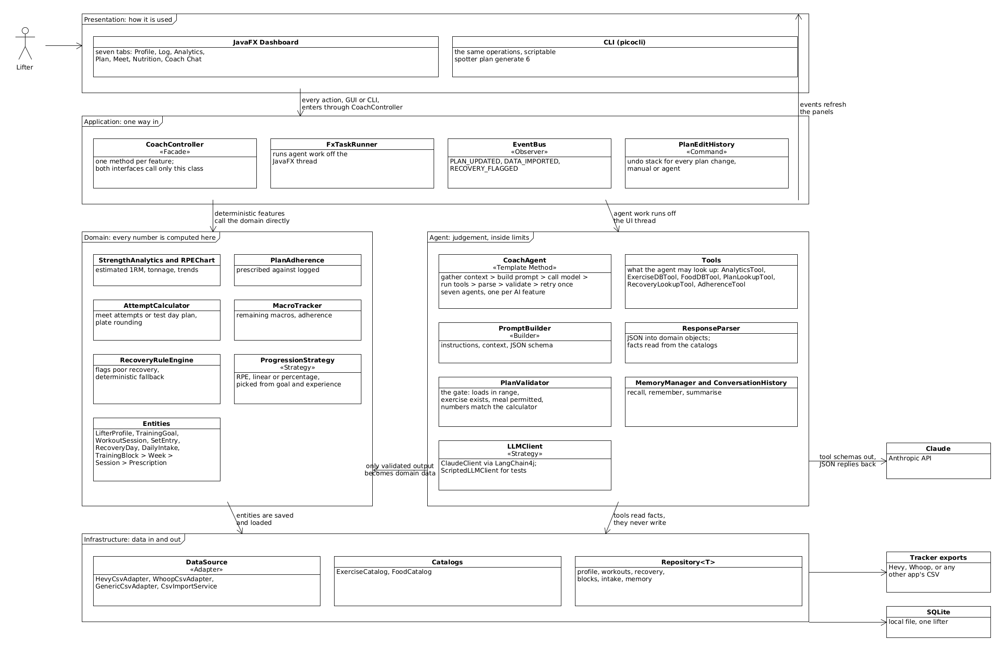

# Spotter: An AI Strength and Nutrition Coaching Agent

EECS 3311 Software Design, Fall 2026 course project, York University.

Spotter imports a lifter's training history and recovery data, computes strength metrics deterministically, and uses an LLM agent to plan training blocks, adapt sessions to recovery, substitute unavailable exercises, plan meet attempts, suggest meals against remaining macros, and answer coaching questions. It has a JavaFX dashboard with eight screens, a floating Ask coach drawer, light and dark themes, a guided tour and PDF and CSV report export, and a picocli command line with the same features.

The principle the design rests on is that the model proposes and deterministic code disposes. Every figure a lifter trains off is calculated in ordinary Java. No model output reaches the domain model without passing a parser and a validator.

## Project stages

| Stage | Description | Status |
|---|---|---|
| Stage 1 | Design report: [docs/Spotter_Stage1_Report.md](docs/Spotter_Stage1_Report.md) | Complete, submitted |
| Stage 2 | Implementation: [docs/Spotter_Stage2_Report.md](docs/Spotter_Stage2_Report.md) ([PDF](docs/Spotter_Stage2_Report.pdf)) | Complete. 14 of 14 features, 8 of 8 patterns, 510 tests |
| Stage 3 | Testing (KUMA agent testing) | Not started. The `--json` output the harness drives is in place |

**Student:** Dev Parikh, 219957794

## Stage 2: build, run and demo

The full write up is the [Stage 2 report](docs/Spotter_Stage2_Report.md). It maps every feature to its classes and methods, shows the updated class diagrams, records the design changes and their reasons, and indexes the demonstration videos. Supporting documents are listed under Project documents below.

## Prerequisites

- JDK 21
- Maven 3.9 or newer
- An Anthropic API key, optional. Without one everything deterministic still works.

More detail is in [SETUP.md](SETUP.md).

## Install dependencies and build

```
mvn -q compile
mvn test
```

The 510 tests use a scripted model client, so they need no network and no key.

## Local configuration (API key)

1. Copy the template: `cp .env.example .env`
2. Open `.env` and replace `YOUR_LOCAL_API_KEY_HERE` with your own key.
3. The two models are set by `LLM_MODEL` (Haiku, for choosing and short checked answers) and `LLM_MODEL_REASONING` (Sonnet, for writing whole blocks). Cost rates are `LLM_INPUT_PER_MILLION` and `LLM_OUTPUT_PER_MILLION`.

`.env` is git ignored and must stay that way. The database defaults to `spotter.db` and can be moved with `SPOTTER_DB_PATH`.

## Launch

Graphical dashboard:

```
mvn javafx:run
```

Command line:

```
mvn -q package
java -jar target/spotter.jar status
```

Guided tour of every screen, started automatically:

```
SPOTTER_TOUR=1 mvn javafx:run
```

## Safe sample data (try it without any real data)

```
java -jar target/spotter.jar seed
```

`seed` loads a sample lifter with twenty sessions, recovery readings, foods and the standard exercises. The `sample-data/` folder has three small synthetic files for the import paths, with the commands that use them in `sample-data/README.md`: `hevy-export-sample.csv`, `whoop-export-sample.csv` and `programme-sample.csv`.

## Example usage (CLI)

```
spotter status
spotter seed
spotter import sample-data/hevy-export-sample.csv
spotter import sample-data/whoop-export-sample.csv
spotter analytics squat
spotter recovery --weeks 4
spotter checkin --soreness 3 --energy 4 --sleep 7
spotter attempts squat --explain
spotter testday squat
spotter plan --weeks 4 --days 4 --trace
spotter substitute "Back Squat" --load 140
spotter adjust --fallback
spotter meal --calories 900
spotter review --revise
spotter adopt --keep --start 2026-11-09 --entry "1/1 Back Squat 5x5@120"
```

Add `--trace` to any agent command to see every tool call, every refused proposal and the reason, and the tokens and cost of the run. Add `--demo` to use a prepared reply instead of the API, and `--json` for machine readable output.

Nine of the fifteen commands never call a model.

## Features and where they live

| ID | Feature | Main classes | Report |
|---|---|---|---|
| F01 | Lifter Profile and Constraints | `LifterProfile`, `ProfilePanel`, `ProfileRepository` | [Report](docs/Spotter_Stage2_Report.md#f01--lifter-profile-and-constraints) |
| F02 | Workout Logging and Import | `DataSource`, `HevyCsvAdapter`, `GenericCsvAdapter`, `CsvImportService`, `ImportPanel` | [Report](docs/Spotter_Stage2_Report.md#f02--workout-logging-and-import) |
| F03 | Recovery Input | `WhoopCsvAdapter`, `RecoveryDay`, `RecoveryRuleEngine`, `CheckInCommand` | [Report](docs/Spotter_Stage2_Report.md#f03--recovery-input) |
| F04 | Strength Analytics | `StrengthAnalytics`, `RPEChart`, `AnalyticsPanel` | [Report](docs/Spotter_Stage2_Report.md#f04--strength-analytics) |
| F05 | Training Block Generation | `BlockGenerationAgent`, `CoachAgent`, `PlanValidator`, `ProgressionStrategy` | [Report](docs/Spotter_Stage2_Report.md#f05--training-block-generation) |
| F06 | Equipment Substitution | `SubstitutionAgent`, `Substitution`, `SwapExerciseCommand` | [Report](docs/Spotter_Stage2_Report.md#f06--equipment-substitution) |
| F07 | Recovery Aware Session Adjustment | `AdjustmentAgent`, `RecoveryRuleEngine`, `ApplyAdjustmentCommand` | [Report](docs/Spotter_Stage2_Report.md#f07--recovery-aware-session-adjustment) |
| F08 | Max Testing and Attempt Planning | `AttemptCalculator`, `AttemptRationaleAgent`, `TestDayPlan` | [Report](docs/Spotter_Stage2_Report.md#f08--max-testing-and-attempt-planning) |
| F09 | Macro Targets and Adherence Tracking | `MacroTracker`, `MacroTarget`, `NutritionPanel` | [Report](docs/Spotter_Stage2_Report.md#f09--macro-targets-and-adherence-tracking) |
| F10 | Meal Suggestion | `MealSuggestionAgent`, `FoodCatalog`, `FoodDBTool` | [Report](docs/Spotter_Stage2_Report.md#f10--meal-suggestion) |
| F11 | Coaching Chat with Memory | `ChatAgent`, `MemoryManager`, `ConversationHistory`, `CoachPanel` | [Report](docs/Spotter_Stage2_Report.md#f11--coaching-chat-with-memory) |
| F12 | Plan Adherence and Progression Review | `PlanAdherence`, `ProgressionAgent`, `ApplyProgressionCommand` | [Report](docs/Spotter_Stage2_Report.md#f12--plan-adherence-and-progression-review) |
| F13 | Guided Onboarding | `OnboardingAgent`, `ProfileDraft`, `ProfileValidator` | [Report](docs/Spotter_Stage2_Report.md#f13--guided-onboarding) |
| F14 | Adopt an Existing Programme | `AdoptCommand`, `ProgrammeParserAgent`, `ProgrammeImportService` | [Report](docs/Spotter_Stage2_Report.md#f14--adopt-an-existing-programme) |

Patterns: Facade (`CoachController`), Strategy (`LLMClient`, `ProgressionStrategy`), Template Method (`CoachAgent`), Adapter (`DataSource`), Factory Method (`DataSourceFactory`, `ProgressionStrategyFactory`), Decorator (`CachingLLMClient`, `RecordingLLMClient`), Observer (`EventBus`), Command (`PlanEditCommand`), with Builder and Repository as supporting patterns.

Layers: `presentation` (CLI and JavaFX), `application` (Facade, event bus, plan commands), `domain`, `agent` and `infrastructure`, under `src/main/java/ca/yorku/eecs3311/spotter`.

## How the AI is used (and kept honest)

- Every agent proposal is parsed by `ResponseParser` and checked by `PlanValidator`. A refused proposal goes back to the model with the reason, and nothing unchecked is saved.
- `--trace` shows each step the agent took, each tool it called, each rejection, and the tokens and cost at the end.
- Only `ClaudeClient` imports LangChain4j. Everything else depends on the `LLMClient` interface, which is how the tests run without a key.

## Project documents

- [Stage 1 design report](docs/Spotter_Stage1_Report.md)
- [Stage 2 implementation report](docs/Spotter_Stage2_Report.md) and [PDF](docs/Spotter_Stage2_Report.pdf)
- [Feature to implementation mapping](docs/stage2/feature-to-implementation.md)
- [Design changes](docs/stage2/design-changes.md)
- [AI tools used](docs/stage2/ai-tools.md)
- [AI human collaboration log](docs/stage2/ai-collaboration-log.md)
- [Diagrams, as PNG and UMLet](docs/diagrams/README.md)

## Diagrams

The Stage 2 report carries the updated class diagram (section 3.10) as five views, and the Stage 1 report carries the use case diagram and sequence diagrams, which are unchanged.



| Diagram | File |
|---|---|
| Use case diagram | [usecase.png](docs/diagrams/png/usecase.png) |
| Class diagram, complete | [class-full.png](docs/diagrams/png/class-full.png) |
| Class diagram, presentation and application | [class-presentation-application.png](docs/diagrams/png/class-presentation-application.png) |
| Class diagram, domain | [class-domain.png](docs/diagrams/png/class-domain.png) |
| Class diagram, agent | [class-agent.png](docs/diagrams/png/class-agent.png) |
| Class diagram, infrastructure | [class-infrastructure.png](docs/diagrams/png/class-infrastructure.png) |

All diagrams are also available as UMLet `.uxf` files, see [docs/diagrams/README.md](docs/diagrams/README.md).

## Demonstration videos

There is one GUI demo and two CLI demos, indexed in section 7 of the Stage 2 report. GUI demo: the captioned tour of every screen ([watch](https://youtu.be/QMOtI4h0Y5E)). CLI demo, deterministic commands ([watch](https://youtu.be/IFqLJAf8m-g)). CLI demo, the agent with `--trace` ([watch](https://youtu.be/R0Z8aMzREhE)). Each link in the table jumps to that feature's segment. Where a feature has two CLI segments they are on separate lines.

| ID | Feature | Report | GUI demo | CLI demo |
|---|---|---|---|---|
| F01 | Lifter Profile and Constraints | [Report](docs/Spotter_Stage2_Report.md#f01--lifter-profile-and-constraints) | [2:05](https://youtu.be/QMOtI4h0Y5E?t=125) | |
| F02 | Workout Logging and Import | [Report](docs/Spotter_Stage2_Report.md#f02--workout-logging-and-import) | | [0:13](https://youtu.be/IFqLJAf8m-g?t=13) |
| F03 | Recovery Input | [Report](docs/Spotter_Stage2_Report.md#f03--recovery-input) | | [1:46](https://youtu.be/IFqLJAf8m-g?t=106) |
| F04 | Strength Analytics | [Report](docs/Spotter_Stage2_Report.md#f04--strength-analytics) | [0:50](https://youtu.be/QMOtI4h0Y5E?t=50) | [2:41](https://youtu.be/IFqLJAf8m-g?t=161) |
| F05 | Training Block Generation | [Report](docs/Spotter_Stage2_Report.md#f05--training-block-generation) | [0:38](https://youtu.be/QMOtI4h0Y5E?t=38) | [0:19](https://youtu.be/R0Z8aMzREhE?t=19) |
| F06 | Equipment Substitution | [Report](docs/Spotter_Stage2_Report.md#f06--equipment-substitution) | [0:25](https://youtu.be/QMOtI4h0Y5E?t=25) | [2:46](https://youtu.be/R0Z8aMzREhE?t=166) |
| F07 | Recovery Aware Adjustment | [Report](docs/Spotter_Stage2_Report.md#f07--recovery-aware-session-adjustment) | [0:25](https://youtu.be/QMOtI4h0Y5E?t=25) | [3:26](https://youtu.be/R0Z8aMzREhE?t=206) |
| F08 | Max Testing and Attempt Planning | [Report](docs/Spotter_Stage2_Report.md#f08--max-testing-and-attempt-planning) | | [3:01 deterministic](https://youtu.be/IFqLJAf8m-g?t=181)<br>[4:31 agent](https://youtu.be/R0Z8aMzREhE?t=271) |
| F09 | Macro Targets and Adherence | [Report](docs/Spotter_Stage2_Report.md#f09--macro-targets-and-adherence-tracking) | [1:11](https://youtu.be/QMOtI4h0Y5E?t=71) | |
| F10 | Meal Suggestion | [Report](docs/Spotter_Stage2_Report.md#f10--meal-suggestion) | [1:11](https://youtu.be/QMOtI4h0Y5E?t=71) | [4:54](https://youtu.be/R0Z8aMzREhE?t=294) |
| F11 | Coaching Chat with Memory | [Report](docs/Spotter_Stage2_Report.md#f11--coaching-chat-with-memory) | [1:22](https://youtu.be/QMOtI4h0Y5E?t=82) | |
| F12 | Plan Adherence and Progression Review | [Report](docs/Spotter_Stage2_Report.md#f12--plan-adherence-and-progression-review) | | [5:19](https://youtu.be/R0Z8aMzREhE?t=319) |
| F13 | Guided Onboarding | [Report](docs/Spotter_Stage2_Report.md#f13--guided-onboarding) | [2:05](https://youtu.be/QMOtI4h0Y5E?t=125) | |
| F14 | Adopt an Existing Programme | [Report](docs/Spotter_Stage2_Report.md#f14--adopt-an-existing-programme) | | [6:57](https://youtu.be/R0Z8aMzREhE?t=417) |

## Safety

No API keys or personal data are in this repository. `.env`, local databases and recorded model traffic are git ignored.
